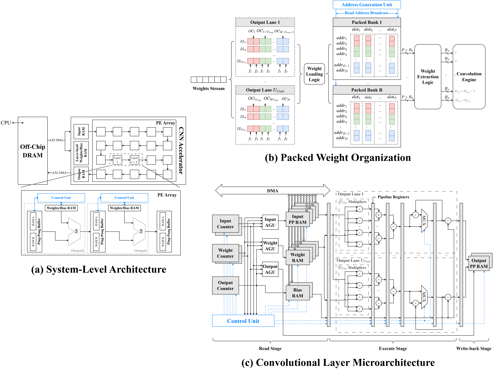

<h1 align="center">VNN: A High-Performance RTL Accelerator<br>for Edge CNN Inference on FPGAs</h1>

<p align="center">
  <strong>Zhu Wenbo, Tan Chou Rong Roel, Ng Joo An Sean, and <a href="https://scholar.google.com.sg/citations?user=CjZGfo8AAAAJ">Rajesh C. Panicker</a></strong>
</p>

<!-- Replace ARXIV_ID with the paper identifier and uncomment this block after publication.
<p align="center">
  <a href="https://arxiv.org/abs/ARXIV_ID">
    
  </a>
  <a href="https://arxiv.org/pdf/ARXIV_ID">
    
  </a>
</p>
-->

<p align="center">
  <a href="assets/vnn-architecture.png">
    
  </a>
</p>

---

VNN (Verilog Neural Network) is a high-performance RTL accelerator for multi-bit fixed-point CNN inference on edge FPGAs. It combines layer-wise pipelining, channel parallelism, packed on-chip memory, and register-level timing optimization to achieve high inference throughput under FPGA resource constraints.

Implemented as a 16-bit Q6.10 CIFAR-10 classifier on the AMD Kria KV260 Vision AI Starter Kit, VNN achieves **6,771.3 FPS and 523.2 GOPS at 333 MHz**, with **22.39 GOPS/kLUT** and a Vivado-estimated on-chip power consumption of **3.909 W**, corresponding to **1,732.2 FPS/W and 133.8 GOPS/W**.

## Table of Contents

- [Architecture](#architecture)
- [Repository structure](#repository-structure)
- [Getting started](#getting-started)
- [Citation](#citation)
- [License](#license)

## Architecture

VNN combines four architectural techniques to achieve high-throughput CNN inference on FPGAs:

- **Layer-wise pipelining:** Each CNN layer is mapped to a dedicated processing stage. Adjacent layers exchange intermediate feature maps through ping-pong buffers, enabling concurrent execution across layers on different input images.
- **Channel parallelism:** Input- and output-channel unrolling exploit arithmetic parallelism within convolutional layers.
- **Packed on-chip memory:** Word packing combines multiple weights into wider memory words, reducing the number of logical memory banks and improving BRAM/URAM utilization efficiency while maintaining parallel weight access.
- **Timing optimization:** Localized pipeline-register insertion shortens critical combinational paths while maintaining data/control alignment. Register replication distributes high-fanout loads to alleviate routing-related timing bottlenecks.

VNN targets CNNs whose parameters and ping-pong-buffered intermediate feature maps fit within the available on-chip memory. Model parameters are loaded into layer-local RAM once per image batch, while intermediate feature maps remain on chip throughout inference, avoiding repeated off-chip memory accesses.

### Reference Network

VNN is evaluated using a custom CNN for CIFAR-10 classification. The network consists of six 3 × 3 convolutional layers following a Conv–BatchNorm–ReLU pattern, with output-channel counts of 32, 32, 64, 64, 128, and 128. Max pooling reduces the spatial dimensions from 32 × 32 to 16 × 16 and then to 8 × 8. The network ends with global average pooling and a fully connected layer for ten-class classification.

The network is trained in PyTorch for 200 epochs using the AdamW optimizer with cosine learning rate decay. Training includes input normalization, random cropping, and horizontal flipping. After training, batch normalization is folded into the convolution parameters, and the learned weights are quantized to 16-bit Q6.10 fixed-point representation for FPGA inference. The network architecture is shown as follows:

| Layer | Output dimensions | MACs |
|---|---|---:|
| Conv2D + ReLU | 32 × 32 × 32 | 884,736 |
| Conv2D + ReLU | 32 × 32 × 32 | 9,437,184 |
| MaxPool | 32 × 16 × 16 | – |
| Conv2D + ReLU | 64 × 16 × 16 | 4,718,592 |
| Conv2D + ReLU | 64 × 16 × 16 | 9,437,184 |
| MaxPool | 64 × 8 × 8 | – |
| Conv2D + ReLU | 128 × 8 × 8 | 4,718,592 |
| Conv2D + ReLU | 128 × 8 × 8 | 9,437,184 |
| Global AvgPool | 128 | – |
| Fully Connected | 10 | 1,280 |
| **Total** | | **38,634,752** |

The network requires **38,634,752 MACs per image** and **288,298 parameter words**. Each MAC counts as two operations when reporting throughput in GOPS.

## Repository structure

```text
rtl/             VNN RTL implementation
  interfaces/    AXI-stream image input and result output
  util/          Shared counter and RTL utilities
hls/             Same-network HLS baseline and Vitis project flow
tb/rtl/          RTL layer and system testbenches
tb/hls/          HLS C simulation testbench
tb/data/         Parameter tensors and simulation-vector locations
model/           Model definition, checkpoint, dataset, exporter, and CPU/CUDA baselines
pynq/            FPGA board inference applications
```

## Getting Started

VNN provides two FPGA implementations of the same CNN: a hand-written RTL accelerator and a Vitis HLS baseline. Both were evaluated on the **AMD Kria KV260 Vision AI Starter Kit** using Vivado for hardware integration and PYNQ for board-level inference.

The repository contains the accelerator sources, testbenches, trained model, quantized parameters, and inference applications. Vivado block designs, board-specific constraints, and prebuilt overlays are not included and must be configured separately. The following instructions outline the implementation workflows, with references to the NUS EE4218 lab guides for hardware platform setup, IP integration, and PYNQ deployment.

### Prerequisites

- AMD Vivado Design Suite with support for the Kria KV260
- AMD Vitis HLS for the HLS implementation
- Kria KV260 running a compatible Linux/PYNQ environment
- Python 3, NumPy, and PyTorch for model utilities
- Required model checkpoint and evaluation data (included in the repository)

> [!NOTE]
> This design was validated using AMD Vivado and Vitis 2026.1. While other recent tool versions may be compatible, minor adjustments to constraints or synthesis settings might be required.

### RTL Implementation

The RTL accelerator is implemented in Verilog and integrated into the KV260 hardware platform using Vivado IP Integrator.

1. **Create the Vivado project.** Follow the [EE4218 hardware platform guide](https://nus-ee4218.github.io/Lab_2/2_HW_Platform/) to create a KV260 project and configure the Zynq UltraScale+ MPSoC processing system, clocks, resets, and AXI interfaces.
2. **Package the RTL accelerator.** Import the Verilog sources under `rtl/`, including the required interface and utility modules, and package them as a custom Vivado IP. Refer to the [EE4218 IP packaging guide](https://nus-ee4218.github.io/Lab_3/2_PackagingIP/) for the procedure.
3. **Integrate the accelerator.** Add the custom IP and AXI DMA to the Vivado block design. Configure the AXI-Stream connections for input images, model parameters, and inference results, together with the required memory and control interfaces. Follow the [EE4218 AXI DMA integration guide](https://nus-ee4218.github.io/Lab_3/4_DMA/) for the general integration procedure, adapting the connections and interface settings to VNN.
4. **Implement the hardware.** Validate the block design, generate the HDL wrapper, and run synthesis, implementation, and bitstream generation. Apply the required timing constraints and implementation settings. The RTL implementation reported in the paper achieves **333 MHz**.
5. **Export and deploy.** Export the Vivado hardware platform as an XSA with the bitstream included. Transfer the generated `.bit` and `.hwh` files to the KV260 and configure the corresponding overlay paths and IP interfaces. Refer to the [EE4218 PYNQ on Kria guide](https://nus-ee4218.github.io/Lab_4/4_Pynq_OpenCL_Kria/) for board setup and PYNQ deployment.
6. **Run inference.** Execute `pynq/infer_hdl.py` on the KV260 using the required quantized parameters and evaluation images. See the [PYNQ guide](pynq/README.md) for application-specific configuration and execution.

RTL simulation and verification can be performed using the testbenches under `tb/rtl/`. Refer to the [testbench guide](tb/README.md) for additional details.

### HLS Implementation

The HLS baseline implements the same CNN in C++ and uses Vitis HLS to generate RTL for integration into the KV260 hardware platform.

1. **Create the HLS project.** Follow the [EE4218 HLS flow guide](https://nus-ee4218.github.io/Lab_4/2_HLSFLow/) to create a Vitis HLS component targeting the KV260 (K26 FPGA). Import the C++ sources, header files, and testbench under `hls/`, and specify the HLS top function.
2. **Configure and verify the design.** Set the target clock period to **5 ns (200 MHz)**, as used in the paper. Run C simulation to verify functionality, followed by C synthesis to generate RTL and obtain timing and resource estimates. C/RTL co-simulation can be performed for additional verification.
3. **Package the HLS IP.** Package the synthesized design in Vivado IP catalog format for integration into a Vivado block design. Refer to the [EE4218 HLS flow guide](https://nus-ee4218.github.io/Lab_4/2_HLSFLow/) for IP packaging and export.
4. **Integrate and implement in Vivado.** Create a KV260 Vivado project following the [hardware platform guide](https://nus-ee4218.github.io/Lab_2/2_HW_Platform/), add the exported HLS IP to the IP repository, and integrate it with the Zynq UltraScale+ MPSoC and AXI DMA following the [AXI DMA integration guide](https://nus-ee4218.github.io/Lab_3/4_DMA/). Configure the required interfaces and run synthesis, implementation, and bitstream generation.
5. **Export and deploy.** Export the Vivado hardware platform as an XSA with the bitstream included. Transfer the XSA file to the KV260 and configure the corresponding PYNQ overlay. Refer to the [EE4218 PYNQ on Kria guide](https://nus-ee4218.github.io/Lab_4/4_Pynq_OpenCL_Kria/) for deployment instructions.
6. **Run inference.** Execute `pynq/infer_hls.py` on the KV260 using the same quantized model and evaluation dataset as the RTL implementation. See the [PYNQ guide](pynq/README.md) for application-specific configuration and execution.

Refer to the [HLS guide](hls/README.md) for further details on the HLS sources and synthesis flow, and the [testbench guide](tb/README.md) for simulation.

### Model and Evaluation Data

The repository includes the trained model and supporting evaluation files:

| Artifact | Location |
|---|---|
| Trained PyTorch checkpoint | `model/checkpoints/cnn.pth` |
| Quantized model parameters | `model/weights_q6_10.bin` |
| Evaluation image batch | `model/test_batch.bin` |
| RTL simulation parameters and vectors | `tb/data/` |

Additional documentation is available for model preparation and CPU/GPU inference implementations used for performance comparison:

- [Model and data preparation](model/README.md)
- [CPU inference](model/cpu/README.md)
- [CUDA inference](model/cuda/README.md)

> [!NOTE]
> The FPGA flows above describe the integration and deployment procedure rather than an automated, one-command reproduction. Reproducing the reported results requires compatible tool versions, hardware settings, memory initialization files, and PYNQ overlay configurations. The RTL and HLS implementations reported in the paper operate at 333 MHz and 200 MHz, respectively; achieved timing may differ with implementation settings and tool versions.

## Citation

```bibtex
@misc{zhu2026vnn,
  title  = {VNN: A High-Performance RTL Accelerator for Edge CNN Inference on FPGAs},
  author = {Zhu, Wenbo and Tan, Chou Rong Roel and Ng, Joo An Sean and Panicker, Rajesh C.},
  year   = {2026}
}
```

## License

The code is released under the [MIT License](LICENSE).
