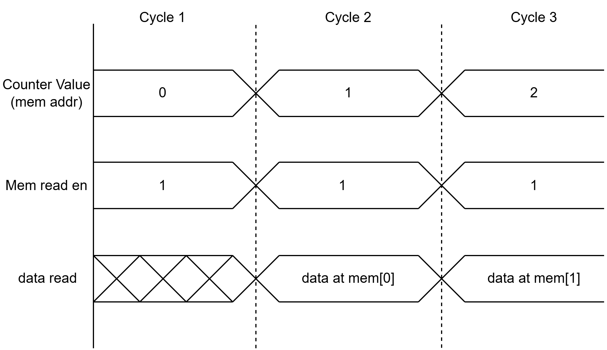
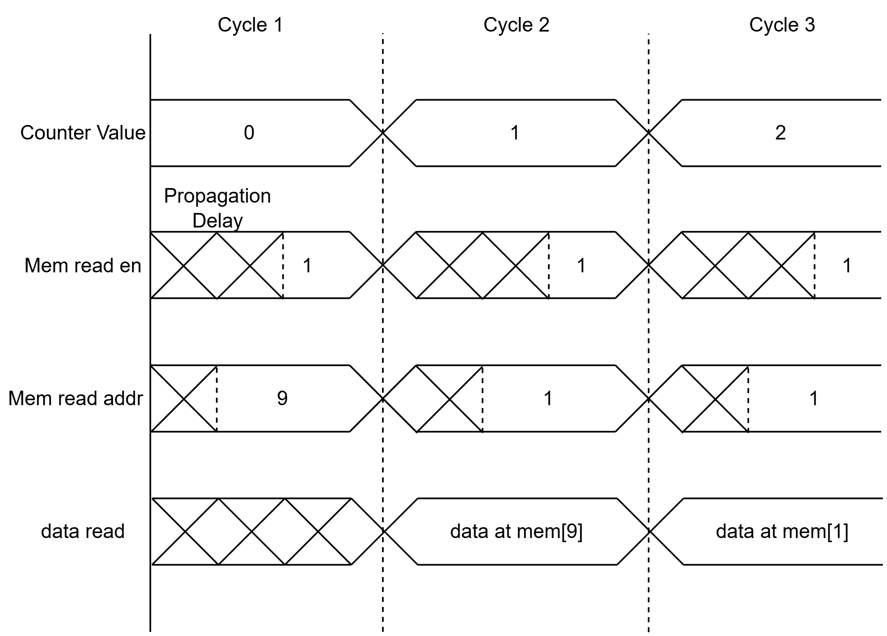
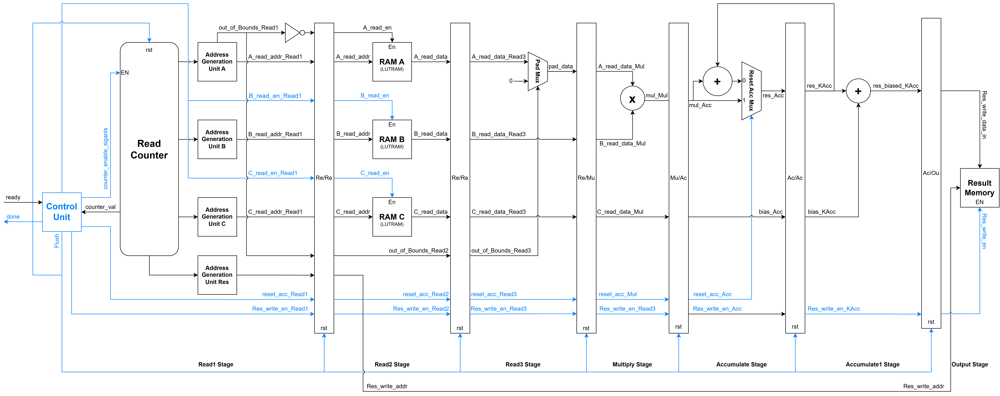
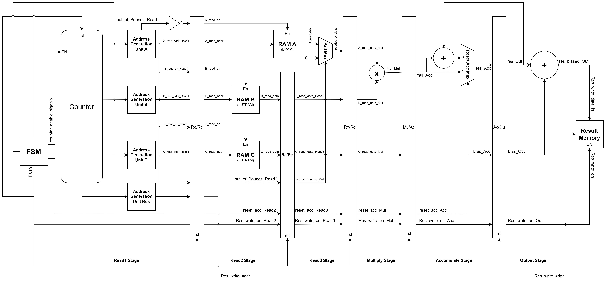
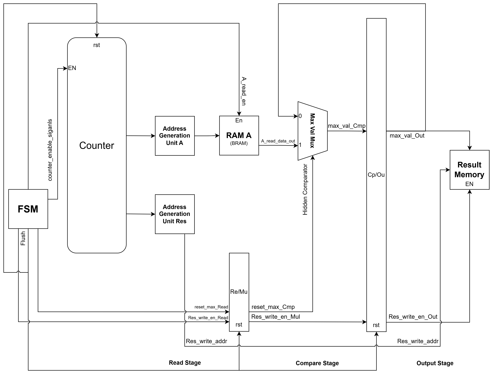
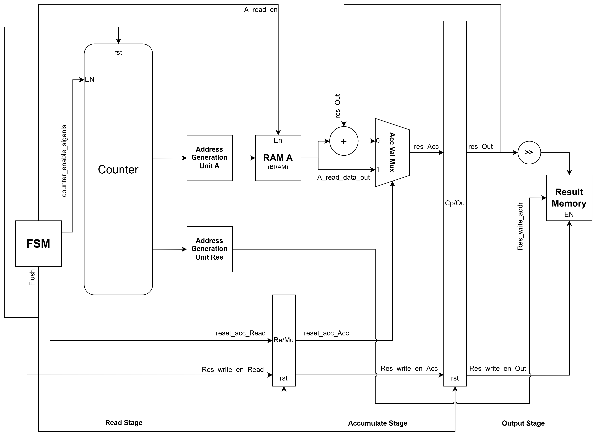
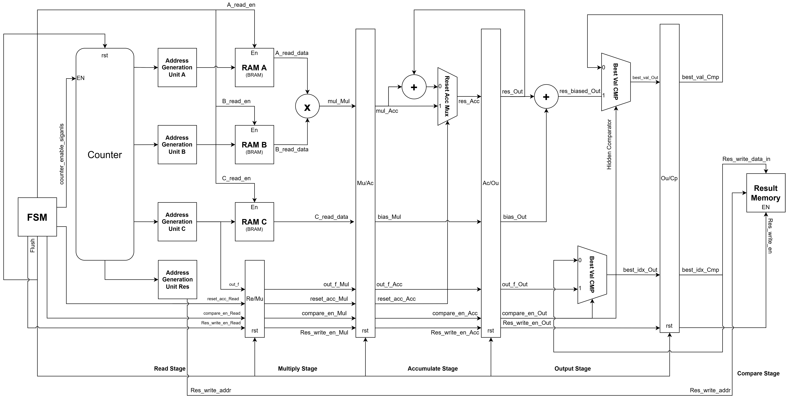
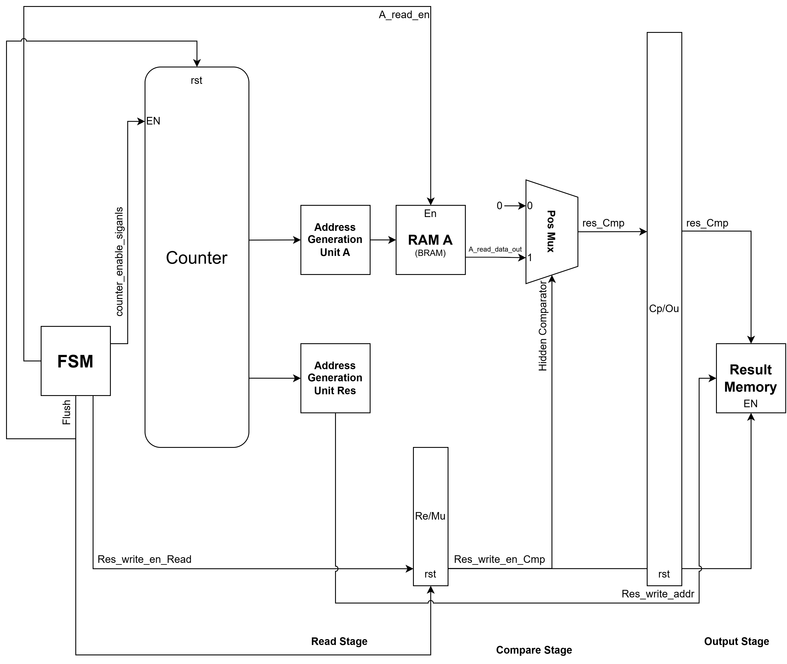

# RTL design and microarchitecture

This guide introduces the design principles behind VNN's RTL implementation,
from control logic and address generation to datapath design. It then illustrates
how these building blocks fit together in simplified microarchitectures for each CNN layer.
See [the model guide](../model/README.md#network-architecture) for the network
architecture and [the testbench guide](../tb/README.md) for simulation setup.

## Table of Contents

- [Motivation](#motivation)
- [Simplified Layer Microarchitectures](#simplified-layer-microarchitectures)
  - [Convolution Layer](#convolution-layer)
  - [Max Pooling Layer](#max-pooling-layer)
  - [Average Pooling Layer](#average-pooling-layer)
  - [Fully Connected Layer](#fully-connected-layer)
  - [ReLU Layer](#relu-layer)

## Motivation

### Drawing Inspiration from Microprocessor Design

The idea starts with understanding what we are going to do in each layer. Essentially, we are doing nothing more than reading data from memory, processing it, and then writing the results back to memory. If you think about it, this is very similar to the microprocessor design we've seen in CG3207, where we read instructions from the Instruction ROM (IROM) and then execute them.

In a microprocessor, the system starts from an initial Program Counter (PC) address, which points to an instruction stored at that address in the IROM. During execution, the PC value is controlled by the program being executed. Another point worth noting is that instructions are generally stored sequentially in the IROM. Thus, the program flow can be controlled relatively easily through the instructions themselves.

However, in an AI coprocessor, the data we are processing is simply numerical data. Unlike instructions in an Instruction Set Architecture (ISA), such as RISC-V or ARM, where different fields of an instruction encode specific meanings, the data itself does not contain the control information required for execution. One important advantage of the pipelined microprocessor design is that the control information is encoded in the instructions. Therefore, we only need to decode each instruction to obtain the corresponding control signals, such as `MemWrite`.

This leads us to an important question: **How can we generate the necessary control signals in an AI coprocessor when the data itself does not contain any control information?**

### Generating Control Signals Using an FSM

To solve this problem, we need a separate module to generate the control signals and then pack them together with the data read from memory in each cycle. This module can be implemented using a simple Finite State Machine (FSM). The control signals generated by the FSM are cycle-accurate and can therefore be aligned with the data as it moves through the datapath.

In short, we are creating a **data packet consisting of the actual data and the corresponding control signals**, which indicate how the data should be processed and whether the final result can be written back to the result memory.

### Reading Data Using Counters

However, having the control signals alone is not enough. We still need to read the actual data, which forms the backbone of our data packet. To implement the data-reading process, we draw inspiration from the Program Counter (PC) and introduce our own **read counter**. Unlike the PC, which is controlled by the program being executed, the read counter is controlled by the FSM.

Depending on our application, we may have multiple read counters in our design. Each counter can be thought of as a `for` loop, where its value indicates the current iteration of that loop. This analogy is particularly useful because, when designing an AI coprocessor, we often start by writing high-level code containing several nested loops and then translate that code into an RTL implementation. The counter outputs can therefore help us keep track of which loop and iteration we are currently executing.

### Address Generation Unit (AGU)

The counter output can sometimes be used directly as the address of the data we want to read from memory. This applies when we are reading data sequentially. For example, if we store a 2-D array in row-major order and want to read the data row by row, the counter value can directly represent the memory address.

However, depending on the application, we may not always read data sequentially. For example, in CNN-based image processing, we may need to read a local grid of pixels from memory to perform a convolution operation. Therefore, we need another module to convert the counter values into the actual memory addresses. We call this module the **Address Generation Unit (AGU)**.

The AGU is essentially a combinational circuit, or simply a wire, depending on the application. Its purpose is to generate the memory addresses and, when necessary, the memory read-enable signals that will be fed into the RAM.

#### Direct Address Mapping

When the AGU is simply a wire, the counter output is directly connected to the memory address input. Assuming we are using synchronous-read memory, such as Block RAM (BRAM), the timing diagram is shown below.

  

#### Combinational Address Generation

When the AGU is implemented as a combinational circuit, it performs additional address calculations based on the counter values before feeding the resulting addresses into memory.

  

One important point to remember is that, for synchronous-read RAM, the data corresponding to an address is available after the active clock edge at which the address is sampled. Therefore, from a pipeline perspective, we can think of synchronous-read RAM or BRAM as behaving similarly to a register: we provide the address as the input, and the corresponding data becomes available in the next pipeline stage.

### Datapath Design and Memory Write Control

After obtaining the data from memory, the remaining task is to design the datapath that performs the required computations. A good practice is to follow the naming convention used by Hennessy and Patterson, where pipeline registers are named according to the stages they separate. For example, a register between the Instruction Decode (ID) and Execute (EX) stages can be named `ID/EX`.

Another important concept in this microarchitecture design is the use of **memory write-enable signals**. As long as our memory has a write-enable port, we can continuously present the calculated results and write addresses to the memory inputs. Whether the data is actually written into memory depends on the write-enable signal.

This allows us to separate the datapath, which continuously produces results, from the control logic, which determines when those results are valid and should be stored.

## Simplified Layer Microarchitectures

With the basic building blocks introduced in the previous section, we can now put them together to construct the microarchitecture for each CNN layer.

Although different layers perform different operations, they share a similar design philosophy: the control unit manages the read counters, the Address Generation Units (AGUs) generate the memory addresses, and the datapath processes the data before writing the results back to memory.

The following sections illustrate the simplified microarchitectures for the convolution, max pooling, average pooling, fully connected, and ReLU layers.

> [!NOTE]
> **Memory naming convention:** Throughout the diagrams, RAM A, RAM B, and RAM C generally correspond to the input feature map, weight, and bias memories, respectively. Their actual roles may vary depending on the layer.
>
> **Simplified illustrations:** These diagrams are intended to illustrate the basic operation and data flow of each layer rather than the exact RTL implementation. In our actual design, we have introduced several additional optimizations to improve timing and overall performance, such as inserting extra pipeline registers to accommodate the three-cycle read latency of BRAM/URAM and reduce critical path delays. These implementation details are omitted from the diagrams for clarity.

### Convolution Layer

The convolution layer is implemented using a pipelined multiply-accumulate (MAC) datapath. Depending on the memory resources used to store the input feature maps, we consider two different microarchitectures.

#### Convolution with LUTRAM (RAM A)

  

<em>Figure 1: Simplified convolution microarchitecture with LUTRAM-based input memory.</em>

#### Convolution with BRAM/URAM (RAM A)

  

<em>Figure 2: Simplified convolution microarchitecture with BRAM/URAM-based input memory.</em>

### Max Pooling Layer

  

<em>Figure 3: Simplified max pooling microarchitecture.</em>

### Average Pooling Layer

  

<em>Figure 4: Simplified average pooling microarchitecture.</em>

### Fully Connected Layer

  

<em>Figure 5: Simplified fully connected microarchitecture.</em>

### ReLU Layer

  

<em>Figure 6: Simplified ReLU microarchitecture.</em>

> [!NOTE]
> In our actual accelerator, ReLU is combined with convolution to reduce
> intermediate memory usage. ReLU is applied before writing the convolution
> results to memory, avoiding a separate intermediate buffer between the two operations.
